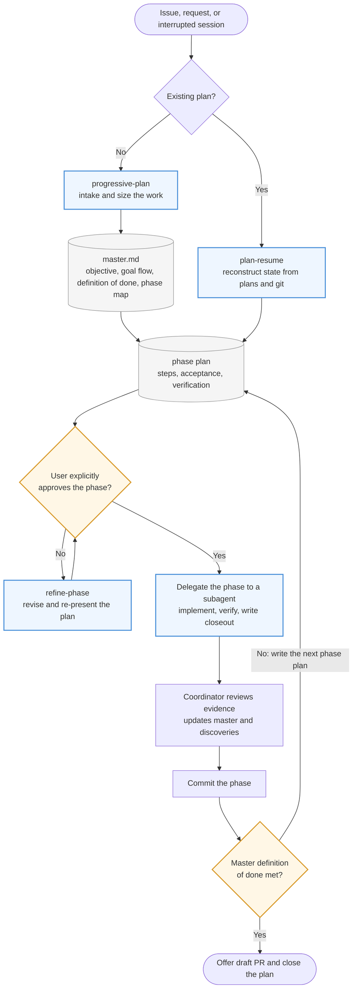

# Progressive Plan

Agent Skills for plan-first coding work: size the task, get explicit approval for each phase, delegate implementation, prove coverage, and commit before calling a phase done.

The skills use the open [Agent Skills](https://agentskills.io) format. Each one is a directory with a `SKILL.md` file, optional `references/`, and optional `scripts/`. The same files work in Pi, Claude Code, Codex, Cursor, and any other agent that reads Agent Skills.

## Skills

| Skill | Use it when |
|---|---|
| `progressive-plan` | Starting from an issue or request, sizing the work, writing a master plan and just-in-time phase plans, approving each phase, and delegating implementation. |
| `plan-resume` | Starting a new session against an existing `docs/plans` master and phase plans, or continuing after an interruption. |
| `refine-phase` | The user rejects an unapproved phase plan or asks for changes before approving it. |

`plan-resume` and `refine-phase` expect `progressive-plan` to be installed next to them.

## Workflow



`progressive-plan` owns the loop: intake, sizing, the master plan, just-in-time phase plans, the approval gate, delegation, closeout, and the commit gate. `refine-phase` handles a rejected phase plan and returns it to the approval gate. `plan-resume` re-enters the loop for an existing plan by reconstructing state from `master.md`, the phase plan, and git history. Implementation does not start until the user explicitly approves the current phase. Each generated `master.md` also carries a `Goal flow` section: a small Mermaid diagram of the user-visible outcome for the person approving phases. Existing masters are upgraded by `plan-resume` before it continues.

## Layout

```
skills/
├── progressive-plan/
│   ├── SKILL.md
│   ├── references/
│   └── scripts/
├── plan-resume/
│   ├── SKILL.md
│   ├── references/
│   └── scripts/
└── refine-phase/
    ├── SKILL.md
    └── references/
```

`skills/` is the canonical location. The repository also links that directory into the agent-specific paths so an agent opened at the repository root finds the skills without an install step:

- `.agents/skills` → `../skills` (Pi, Codex, Cursor, Zed, and other agents)
- `.claude/skills` → `../skills` (Claude Code)
- `.prime/agent/skills` → `../../skills` (prime-agent)

## Install

Use the [Skills CLI](https://skills.sh) to install from this repository into any supported agent:

```bash
# Install into the current project
npx skills add jorgepvenegas/progressive-plan

# Install for every project
npx skills add jorgepvenegas/progressive-plan -g

# Install one skill for one agent
npx skills add jorgepvenegas/progressive-plan --skill progressive-plan -a claude-code -g
```

The CLI detects installed agents. Common agent names are `claude-code` and `pi`. Skills are installed to `.agents/skills/` for Pi and to `.claude/skills/` for Claude Code. Use `-g` for the user-level directories (`~/.agents/skills/` or `~/.claude/skills/`).

Check discovery without installing:

```bash
npx skills add jorgepvenegas/progressive-plan --list
```

Update installed copies with `npx skills update` or by re-running the install command. A copy-based install does not track the repository automatically.

### Manual install

Copy or link each directory under `skills/` into the agent's skills directory:

| Agent | Project path | User path |
|---|---|---|
| Pi, Codex, Cursor, Zed | `.agents/skills/` | `~/.agents/skills/` |
| Claude Code | `.claude/skills/` | `~/.claude/skills/` |
| prime-agent | `.prime/agent/skills/` | `~/.prime/agent/skills/` |

Keep the directory names unchanged. The Agent Skills specification requires `name` to match the parent directory.

## Portability

The skill instructions are harness-neutral. They refer to files relative to the skill directory and describe delegation by capability rather than by one product's API:

- prime-agent: `rlm.spawn` and `agent_message`
- Claude Code: the Task tool
- Pi: the `pi-subagents` tools

Scripts need only Python 3. Run them from the repository root as shown in each skill, and replace `<skill-dir>` with the absolute path to the installed skill.
