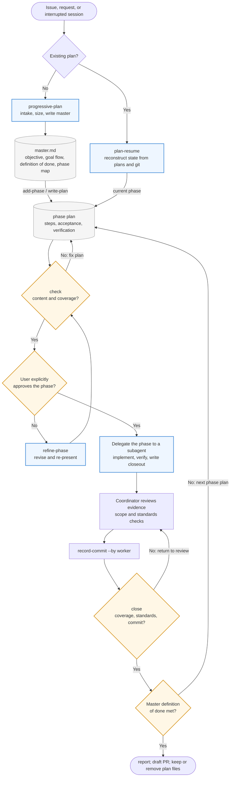

# Progressive Plan

Agent Skills for plan-first coding work: size the task, get explicit approval for each phase, delegate implementation, prove coverage, and commit before calling a phase done.

The skills use the open [Agent Skills](https://agentskills.io) format. Each one is a directory with a `SKILL.md` file, optional `references/`, and optional `scripts/`. The same files work in Pi, Claude Code, Codex, Cursor, and any other agent that reads Agent Skills.

## Skills

| Skill | Use it when |
|---|---|
| `progressive-plan` | Starting from an issue or request, sizing the work, writing a master plan and just-in-time phase plans, approving each phase, and delegating implementation. Supports unattended yolo mode for a whole-plan draft PR. |
| `plan-resume` | Starting a new session against an existing `docs/plans` master and phase plans, or continuing after an interruption. |
| `refine-phase` | The user rejects an unapproved phase plan or asks for changes before approving it. |

`plan-resume` and `refine-phase` expect `progressive-plan` to be installed next to them.

## Workflow



`progressive-plan` owns the loop: intake, sizing, the master plan, just-in-time phase plans, the approval gate, delegation, closeout, and the commit gate. `refine-phase` handles a rejected phase plan and returns it to the approval gate. `plan-resume` re-enters the loop for an existing plan by reconstructing state from `master.md`, the phase plan, and git history. Implementation does not start until the user explicitly approves the current phase, unless the master records yolo mode. Each generated `master.md` also carries a `Goal flow` section: a small Mermaid diagram of the user-visible outcome for the person approving phases. Existing masters are upgraded by `plan-resume` before it continues. Each master records the project's real format, lint, type-check, and test commands, and a phase cannot be `done` while its code standards check is open.

When a plan is ready for review, the skill asks whether to open a draft PR so the user can read it on GitHub. If one is open, every plan, phase, and closeout commit is pushed as it is created. When the master plan is complete, the skill asks whether to keep the plan files or remove them from the PR. Keeping them archives the plan under `docs/plans/archive/<slug>/`, so a new master plan can use the active path again; removing them leaves only the product changes in the PR. After that decision, the skill updates the PR title to a conventional-commit title (`feat:`, `fix:`, and so on) and rewrites the body with the issue, what was done, the decisions, and verification.

`add-phase --outline` adds a `planned` row without a plan; `write-plan` creates the plan just in time. `approve` validates the plan content before recording approval. It refuses a plan that still contains template placeholders, has no steps or acceptance criteria, or omits an affecting discovery. After review, `record-commit` records the phase commit and implementer, and `close` is the only transition that marks a phase done. `close` requires an `addressed` closeout, a `met` row for every criterion and claimed definition-of-done item, a checked code-standards list, an implementer, and a real commit. `check --strict` turns warnings into errors for CI.

`new --size small` uses compact master and phase templates. All sizes keep the same required sections and gates.

## Yolo mode

Yolo mode implements a whole master plan unattended and returns a draft PR for a human to review. The user authorizes it once, at plan creation:

```bash
python3 skills/progressive-plan/scripts/progressive_plan.py new "Overnight import work" \
  --mode yolo --authorized-by "Jorge"
```

The master records `Mode: yolo` and `Mode authorized by: <user>, <date>`. `check` refuses a yolo master without that authorization, and `approve --yolo` refuses a master that is not in yolo mode. Each phase is still planned, checked, delegated to one worker, reviewed, closed out, committed, and pushed. The difference is that phase approval uses the master authorization instead of waiting for the user:

```bash
python3 skills/progressive-plan/scripts/progressive_plan.py approve docs/plans/<slug> P1 --by "Jorge" --yolo
```

The coordinator opens the draft PR before implementation and pushes every commit. At the end it archives the plan files, updates the PR title and body, and leaves the PR as a draft. It never merges, deploys, releases, or marks the PR ready. It stops and reports on a blocked phase, a scope or contract change, a product decision, failing verification that cannot be fixed honestly, a repeated worker failure, missing credentials, or an exhausted budget.

## Commands

```bash
# Scaffold
python3 skills/progressive-plan/scripts/progressive_plan.py new "<Title>" --root docs/plans --size small
python3 skills/progressive-plan/scripts/progressive_plan.py new "<Title>" --mode yolo --authorized-by "Jorge"
python3 skills/progressive-plan/scripts/progressive_plan.py add-phase docs/plans/<slug> "<Phase>" --depends none --outline
python3 skills/progressive-plan/scripts/progressive_plan.py write-plan docs/plans/<slug> P1

# Approve and implement
python3 skills/progressive-plan/scripts/progressive_plan.py approve docs/plans/<slug> P1 --by "<user>"
python3 skills/progressive-plan/scripts/progressive_plan.py approve docs/plans/<slug> P1 --by "<user>" --yolo
python3 skills/progressive-plan/scripts/progressive_plan.py reopen docs/plans/<slug> P1

# Record and close
python3 skills/progressive-plan/scripts/progressive_plan.py record-commit docs/plans/<slug> P1 --by <worker>
python3 skills/progressive-plan/scripts/progressive_plan.py close docs/plans/<slug> P1 --by <worker>

# Track and validate
python3 skills/progressive-plan/scripts/progressive_plan.py add-discovery docs/plans/<slug> P1 "<text>" --affects P1 --type note --action "<text>"
python3 skills/progressive-plan/scripts/progressive_plan.py add-decision docs/plans/<slug> "<text>" --reason "<why>"
python3 skills/progressive-plan/scripts/progressive_plan.py discoveries docs/plans/<slug> P1
python3 skills/progressive-plan/scripts/progressive_plan.py scope docs/plans/<slug> P1
python3 skills/progressive-plan/scripts/progressive_plan.py report docs/plans/<slug>
python3 skills/progressive-plan/scripts/progressive_plan.py archive docs/plans/<slug>
python3 skills/progressive-plan/scripts/progressive_plan.py check docs/plans/<slug> --strict
python3 skills/progressive-plan/scripts/progressive_plan.py status docs/plans/<slug> --json
```

## Layout

```
skills/
├── progressive-plan/
│   ├── SKILL.md
│   ├── references/        # templates, gates, standards, closeout, examples
│   └── scripts/
│       ├── progressive_plan.py
│       └── planlib.py     # shared parser, validation, status, report
├── plan-resume/
│   ├── SKILL.md
│   ├── references/
│   └── scripts/
└── refine-phase/
    ├── SKILL.md
    └── references/
tests/
└── test_*.py
```

`skills/` is the canonical location. The repository also links that directory into the agent-specific paths so an agent opened at the repository root finds the skills without an install step:

- `.agents/skills` → `../skills` (Pi, Codex, Cursor, Zed, and other agents)
- `.claude/skills` → `../skills` (Claude Code)
- `.prime/agent/skills` → `../../skills` (prime-agent)

## Install

Use the [Skills CLI](https://skills.sh) to install from this repository into any supported agent:

```bash
# Install into the current project
npx skills add jorgepvenegas/progressive-plan

# Install for every project
npx skills add jorgepvenegas/progressive-plan -g

# Install one skill for one agent
npx skills add jorgepvenegas/progressive-plan --skill progressive-plan -a claude-code -g
```

The CLI detects installed agents. Common agent names are `claude-code` and `pi`. Skills are installed to `.agents/skills/` for Pi and to `.claude/skills/` for Claude Code. Use `-g` for the user-level directories (`~/.agents/skills/` or `~/.claude/skills/`).

Check discovery without installing:

```bash
npx skills add jorgepvenegas/progressive-plan --list
```

Update installed copies with `npx skills update` or by re-running the install command. A copy-based install does not track the repository automatically.

### Manual install

Copy or link each directory under `skills/` into the agent's skills directory:

| Agent | Project path | User path |
|---|---|---|
| Pi, Codex, Cursor, Zed | `.agents/skills/` | `~/.agents/skills/` |
| Claude Code | `.claude/skills/` | `~/.claude/skills/` |
| prime-agent | `.prime/agent/skills/` | `~/.prime/agent/skills/` |

Keep the directory names unchanged. The Agent Skills specification requires `name` to match the parent directory.

## Development

The scripts use only the Python standard library. Run the tests from the repository root:

```bash
python3 -m unittest discover -s tests -v
```

The tests scaffold plans in temporary directories and exercise approval, outline phases, malformed rows, dependency cycles, discovery propagation, closeout coverage, commit recording, branch reconciliation, and scope checks.

CI runs the same command on every push and pull request.

## Portability

The skill instructions are harness-neutral. They refer to files relative to the skill directory and describe delegation by capability rather than by one product's API:

- prime-agent: `rlm.spawn` and `agent_message`
- Claude Code: the Task tool
- Pi: the `pi-subagents` tools

Scripts need only Python 3. Run them from the repository root as shown in each skill, and replace `<skill-dir>` with the absolute path to the installed skill.
