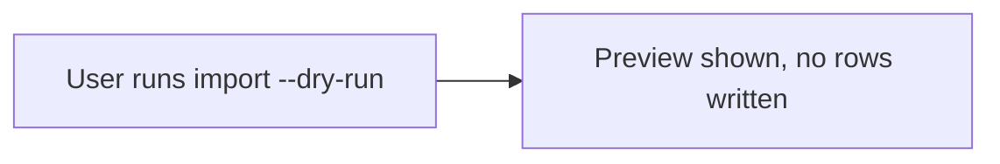

# Worked example: a small one-phase plan

This is a filled example, not a template. It shows the minimum useful content for a small task: one outcome, one definition-of-done item, one phase, one step, one acceptance criterion, and a closeout.

## `master.md`

```markdown
# Master Plan — Add a `--dry-run` flag

- Plan ID: `add-dry-run`
- Master version: 2
- Status: active
- Created: 2026-11-14
- Source: user request
- Size: small
- Owner: coordinator
- Plan directory: `docs/plans/add-dry-run`
- Branch: `plan/add-dry-run`

## 1. Objective

Let users preview an import without writing rows, so a bad file can be checked safely.

## 2. Goal flow



## 3. Definition of done

- [x] D1 — `import --dry-run` prints the row count and writes nothing — verify: `pytest tests/test_import.py -k dry_run`

## 4. Code standards

| Topic | Rule or command |
|---|---|
| Source of truth | `AGENTS.md` |
| Format | `ruff format --check .` |
| Lint | `ruff check .` |
| Type check | `mypy .` |
| Tests | `pytest` |
| Project rules | none |

## 5. Non-goals

- No CSV export in this plan.

## 6. Current state and assumptions

| Area | Evidence | Constraint or surprise |
|---|---|---|
| Import | `src/imports.py:42` — `run_import` | It writes inside the loop |
| Baseline | `pytest` — 118 passed | none |

**Assumptions:** the preview can use the existing parser.
**Unknowns:** none.

## 7. Phase map

| ID | Phase | Outcome | Depends on | Status | Plan |
|---|---|---|---|---|---|
| P1 | Dry run | Preview works without writes | none | done | [plan](phases/01-dry-run/plan.md) |

## 8. Cross-phase decisions

| ID | Date | Decision | Reason | Affects |
|---|---|---|---|---|

## 9. Discovery ledger

| ID | Date | Phase | Affects | Discovery | Type | Action taken | Status |
|---|---|---|---|---|---|---|---|
| L1 | 2026-11-14 | P1 | P1 | The writer commits per row | note | Preview uses the parser only | applied |

## 10. Open questions, risks, and blockers

| ID | Question or risk | Owner | Needed by | Status |
|---|---|---|---|---|

## 11. Closeout history

| Phase | Date | Verdict | Criteria met | Commit | Report |
|---|---|---|---|---|---|
| P1 | 2026-11-14 | addressed | A1 | `a1b2c3d` | [report](phases/01-dry-run/plan.md) |

## 12. Resume brief

- Current phase: none
- Last verdict: addressed
- Next action: offer a draft PR
- Open decisions: none
- PR: none
- Last updated: 2026-11-14
```

## `phases/01-dry-run/plan.md` (excerpt)

```markdown
# Phase P1 — Dry run

- Plan ID: `add-dry-run`
- Phase: P1
- Plan version: 2
- Validated against master version: 2
- Status: done
- Approved by: Jorge
- Approved at: 2026-11-14
- Commit: `a1b2c3d`
- Implementation mode: subagent
- Implemented by: worker-1
- Implemented at: 2026-11-14
- Parallel safe: no
- Depends on: none

## 1. Phase objective

Add a preview path that uses the parser and skips the writer.

## 2. Master traceability

| Master item | How this phase advances it | Phase criterion |
|---|---|---|
| D1 | Adds the preview behavior | A1 |

## Prior discoveries applied

| Ledger | Discovery | Effect on this phase |
|---|---|---|
| L1 | The writer commits per row | S1 calls the parser only |

## 3. Scope

In scope:
- `--dry-run` preview.

Out of scope:
- CSV export.

## 4. Entry conditions

- [x] Import tests pass — verify: `pytest tests/test_import.py`
- [x] Phase plan revalidated against current master version
- [x] User approved this phase plan — verify: `Approved by` is set

## 5. Steps

### S1 — Add the preview path

- Depends on: none
- Files:
  - `src/imports.py` (modify) — `run_import`
  - `tests/test_import.py` (modify) — dry-run test
- Change: parse rows, print the count, skip `write_row` when `dry_run` is true.
- Acceptance:
  - [x] A dry run writes no rows.
- Verification: `pytest tests/test_import.py -k dry_run` — expected: 1 passed
- Rollback: remove the branch.

## 6. Phase acceptance criteria

- [x] A1 — A dry run prints the count and writes nothing — verify: `pytest tests/test_import.py -k dry_run`

## 7. Code standards check

- [x] The diff is the smallest change that meets the acceptance criteria
- [x] Existing helpers are reused where they fit
- [x] Names and structure state intent
- [x] Tests assert observable behavior
- [x] Master standards commands pass: `ruff format --check .`, `ruff check .`, `mypy .`, `pytest`

## 8. Risks and unknowns

| Risk | Likelihood | Impact | Mitigation or check |
|---|---|---|---|
| Preview drifts from the writer | medium | medium | Share the parser and test both paths |

## 9. Deviations and working notes

None.

## 10. Closeout

- Date: 2026-11-14
- Session: dry-run
- Verdict: addressed
- Steps complete: S1
- Verification run: `pytest tests/test_import.py -k dry_run` — 1 passed

| Criterion | Verdict | Evidence |
|---|---|---|
| A1 | met | `pytest tests/test_import.py -k dry_run` — 1 passed |
| D1 (master) | met | `pytest tests/test_import.py -k dry_run` — 1 passed |

**Discoveries no earlier plan predicted:** none
**Master updates written:** v2, L1, closeout history
**Next-phase updates written:** none
**Remaining work and handoff:** none
```
