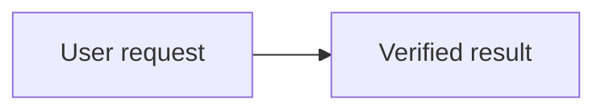

# Master Plan — {{TITLE}}

- Plan ID: `{{SLUG}}`
- Master version: 1
- Status: draft
- Created: {{DATE}}
- Source: <issue URL, ticket ID, or user request>
- Size: {{SIZE}}
- Owner: <coordinator agent or user>
- Plan directory: `{{PLAN_DIR}}`
- Branch: `{{BRANCH}}`

`Status` is one of `draft`, `active`, `complete`, or `blocked`.

## 1. Objective

<One or two sentences: the user-visible outcome.>

## 2. Goal flow

Replace the two nodes with the concrete start and result. No phase IDs or component names.

## 3. Definition of done

- [ ] D1 — <observable result> — verify: `<command or observation>`

## 4. Code standards

| Topic | Rule or command |
|---|---|
| Source of truth | `<AGENTS.md, CLAUDE.md, contributor docs, tool config>` |
| Format | `<command or none>` |
| Lint | `<command or none>` |
| Type check | `<command or none>` |
| Tests | `<command>` |
| Project rules | <non-obvious conventions, or none> |

## 5. Non-goals

- <Adjacent work explicitly excluded>

## 6. Current state and assumptions

| Area | Evidence | Constraint or surprise |
|---|---|---|
| Request | <source and date read> | <scope and gap answers> |
| Baseline | `<command>` — <result> | <failures or warnings> |

**Assumptions:** <facts not verified, or none>
**Unknowns:** <remaining unknowns, or none>

## 7. Phase map

| ID | Phase | Outcome | Depends on | Status | Plan |
|---|---|---|---|---|---|

Status: `planned`, `ready`, `in_progress`, `done`, `blocked`, `needs_replan`, `superseded`.
Use `add-phase --outline` and `write-plan` for a one-phase plan. `Parallel safe: yes` in a phase plan allows intentional parallel work.

## 8. Cross-phase decisions

| ID | Date | Decision | Reason | Affects |
|---|---|---|---|---|

## 9. Discovery ledger

| ID | Date | Phase | Affects | Discovery | Type | Action taken | Status |
|---|---|---|---|---|---|---|---|

Types: `note`, `phase-amend`, `next-phase-amend`, `master-amend`, `new-phase`, `scope-change`, `plan-defect`.
Statuses: `open`, `applied`, `superseded`, `wontfix`.

## 10. Open questions, risks, and blockers

| ID | Question or risk | Owner | Needed by | Status |
|---|---|---|---|---|

## 11. Closeout history

| Phase | Date | Verdict | Criteria met | Commit | Report |
|---|---|---|---|---|---|

## 12. Resume brief

- Current phase: <ID or none>
- Last verdict: <addressed | partial | blocked | none>
- Next action: <one concrete action>
- Open decisions: <IDs or none>
- PR: <none | draft PR URL>
- Last updated: {{DATE}}
