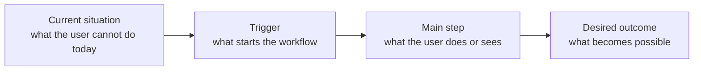

# Master Plan — {{TITLE}}

- Plan ID: `{{SLUG}}`
- Master version: 1
- Status: draft
- Created: {{DATE}}
- Source: <issue URL, ticket ID, or user request>
- Size: small | medium | large
- Owner: <coordinator agent or user>
- Plan directory: `docs/plans/{{SLUG}}`
- Branch: `plan/{{SLUG}}`

## 1. Objective

<One paragraph. The user-visible outcome and who uses it. Do not restate the task as an activity.>

## 2. Goal flow

A high-level view of the user-visible outcome for the person approving phases. Keep it to the main path and avoid implementation detail.

Replace the placeholders with the concrete plan flow. Use three to six nodes, user-visible verbs, and no code symbols, phase IDs, or internal component names. `check` requires this section to contain a fenced `mermaid` block.

## 3. Definition of done

- [ ] D1 — <observable result> — verify: `<command or observation>`
- [ ] D2 — <observable result> — verify: `<command or observation>`

## 4. Code standards

| Topic | Rule or command |
|---|---|
| Source of truth | `<AGENTS.md, CLAUDE.md, contributor docs, tool config>` |
| Format | `<command or none>` |
| Lint | `<command or none>` |
| Type check | `<command or none>` |
| Tests | `<command>` |
| Project rules | <non-obvious conventions the code does not show, or none> |

Write `none` only for a check the project does not have.

## 5. Non-goals

- <Adjacent work explicitly excluded>
- <Cleanup or refactor that must not happen in this plan>

## 6. Current state and assumptions

| Area | Evidence | Constraint or surprise |
|---|---|---|
| Request | <source and date read> | <scope, gap-question answers, and assumptions> |
| <component> | `path:line` — <symbol> | <what limits the design> |
| Baseline | `<command>` — <result> | <failing tests or warnings> |

**Assumptions:** <facts not verified, and how each will be checked>
**Unknowns:** <remaining unknowns and who resolves them>

## 7. Phase map

| ID | Phase | Outcome | Depends on | Status | Plan |
|---|---|---|---|---|---|

Status: `planned`, `ready`, `in_progress`, `done`, `blocked`, `needs_replan`, `superseded`.
`ready` means the user has explicitly approved that phase plan. A written plan is not `ready` until it passes the approval gate. Later phases may stay as outlines; write a phase sub-plan just before that phase starts, then stop and ask for approval.

## 8. Cross-phase decisions

Append-only. Supersede a decision with a new row; never delete history.

| ID | Date | Decision | Reason | Affects |
|---|---|---|---|---|
| C1 | {{DATE}} | <decision> | <why> | <phase IDs> |

## 9. Discovery ledger

Append-only. One row per discovery that changed or could change a plan. Use `note` for findings worth keeping with no plan change.

| ID | Date | Phase | Affects | Discovery | Type | Action taken | Status |
|---|---|---|---|---|---|---|---|

Types: `note`, `phase-amend`, `next-phase-amend`, `master-amend`, `new-phase`, `scope-change`, `plan-defect`.

Every row must have an `Affects` value: `all`, one phase ID, or a comma-separated list/range such as `P3–P5`. `check` fails a `ready`, `in_progress`, or `done` phase that does not list every affecting row in its `Prior discoveries applied` table.

## 10. Open questions, risks, and blockers

| ID | Question or risk | Owner | Needed by | Status |
|---|---|---|---|---|

## 11. Closeout history

| Phase | Date | Verdict | Criteria met | Commit | Report |
|---|---|---|---|---|---|

## 12. Resume brief

- Current phase: <ID or none>
- Last verdict: <addressed | partial | blocked | none>
- Next action: <one concrete action>
- Open decisions: <IDs or none>
- PR: <none | draft PR URL>
- Last updated: {{DATE}}
